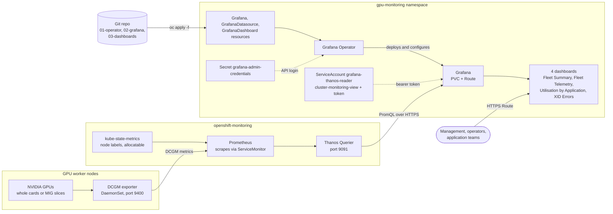

# GPU Monitoring for OpenShift

Grafana dashboards for NVIDIA GPU fleets on OpenShift, deployed with the Grafana Operator and fed by the DCGM exporter that the NVIDIA GPU Operator already runs. They handle fleets that mix MIG-partitioned GPUs, single-instance MIG and whole GPUs without double counting. Works on connected and disconnected clusters.

| Dashboard | For |
|---|---|
| **GPU Fleet Summary** | Management view: usage, memory, power, errors, and which team uses which GPU |
| **GPU Fleet Telemetry** | Operators: per-device inventory, health events, MIG layout per node, idle capacity |
| **GPU Utilisation by Application (MIG-aware)** | Chargeback: usage per namespace and pod in GPU-equivalents, weighted by MIG slice size |
| **GPU XID Errors** | GPUs reporting XID faults |

## How it works



The DCGM exporter on each GPU node publishes GPU metrics, OpenShift's Prometheus scrapes them, and Grafana reads them through Thanos Querier with a read-only service account token. The Grafana Operator turns the YAML in this repo into a running Grafana with its datasource and dashboards, logging in to Grafana's API with the admin Secret.

## Install

Fill in the values marked `CHANGE_ME` (storage class, route host, catalog source), then:

```bash
oc apply -f 01-operator/
# approve the InstallPlan, wait for the CSV to show Succeeded

oc -n gpu-monitoring create secret generic grafana-admin-credentials \
  --from-literal=GF_SECURITY_ADMIN_USER=admin \
  --from-literal=GF_SECURITY_ADMIN_PASSWORD="$(openssl rand -base64 24)"

oc apply -f 02-grafana/
oc apply -f 03-dashboards/
```

**[RUNBOOK.md](RUNBOOK.md)** has the full walkthrough: checks to run before installing, mirroring for disconnected clusters, verification, editing dashboards, adapting to other GPU models, and troubleshooting.

## Layout

```
01-operator/      Namespace, OperatorGroup, Subscription
02-grafana/       Service account for Thanos, Grafana instance with storage and route, datasource
03-dashboards/    The four dashboards (GrafanaDashboard resources)
mirror/           oc-mirror v2 config, disconnected clusters only
RUNBOOK.md        Full install and operations guide
```

## Requirements

OpenShift 4.12+ with cluster monitoring, the NVIDIA GPU Operator with DCGM profiling metrics enabled, and the Grafana Operator v5. Tested on OpenShift 4.18, GPU Operator v25.3, Grafana Operator v5.24.0 and Grafana 13.0.1 with H200 GPUs.
